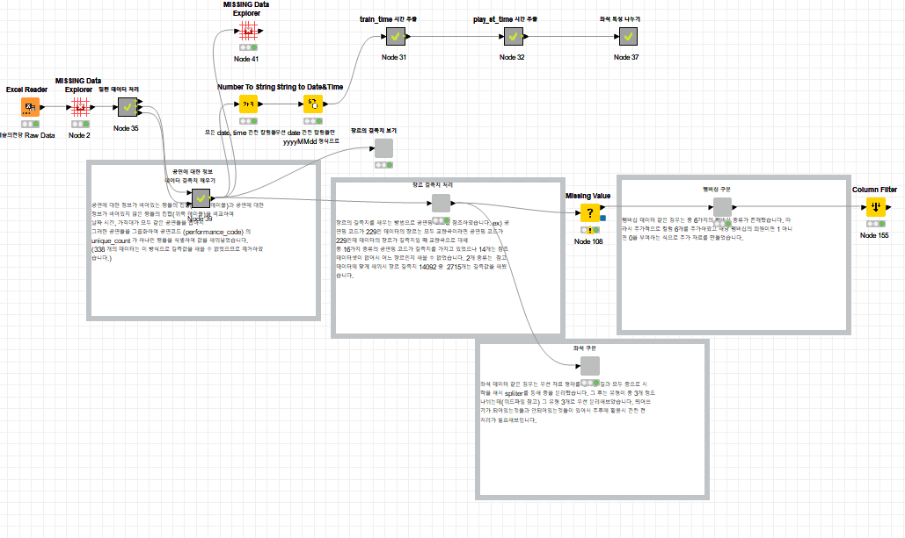
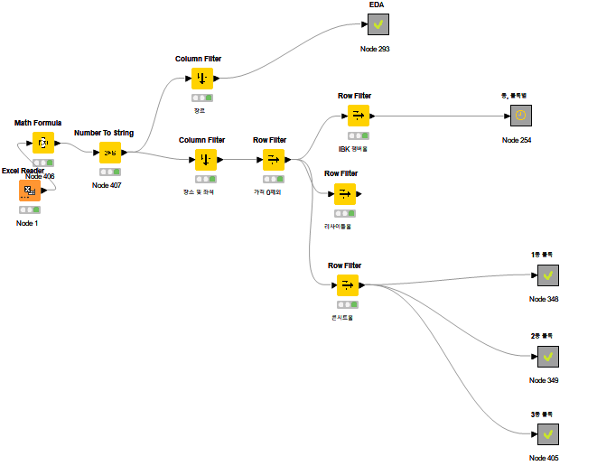
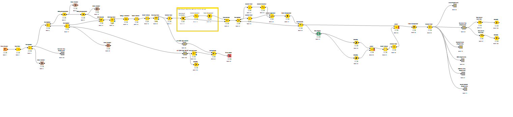

# 예술의전당 콘서트홀 예매 데이터로 적정 가격·예매 취소 예측

**제11회 2023 빅콘테스트 정형데이터분석분야 어드밴스드리그** 출품작
팀 ThreeNodes (3명) · 분석 도구 **KNIME Analytics Platform 5.1**

> 예술의전당 예매 데이터는 대회 주최 측이 제공한 자료라 저장소에 포함하지 않았습니다. 워크플로는 실행 결과(데이터)를 지우고 설계만 내보낸 것입니다.

---

## 파일

| 파일 | 내용 |
|---|---|
| `발표자료_ThreeNodes.pdf` | 2차 발표심사 자료 (56쪽, 표지의 팀원 이름·연락처는 지움) |
| `전처리EDA_데이터제외.knwf` | 데이터 읽기, 결측치·이상치 처리, 변수 정리, EDA |
| `EDA좌석장르_데이터제외.knwf` | 좌석(층·블록·열)과 장르별 가격·취소 비율 EDA |
| `가격모델링_데이터제외.knwf` | 가격 예측 모델: 특성 공학, 6가지 회귀 모델, 변수 선택, 10겹 교차검증 |
| `워크플로_*.PNG` | 각 워크플로의 전체 모습 |

---

## 분석 개요

- **배경:** 엔데믹 이후 대형 공연을 중심으로 공연 시장이 활황이지만, 팬데믹 때의 가격 인상에 대한 소비자 불만이 남아 있음
- **목표:** 소비자 효용을 높이고 예매를 촉진할 수 있는 **적정 가격 예측 모델**과, 좌석 정보를 바탕으로 한 가격·할인 정책 구상
- **목표변수:** 예매 취소 여부(`ticket_cancel`)와 가격(`price`)을 각각 Y1, Y2로 두고, 영향을 줄 것으로 보이는 변수들과의 관계를 바탕으로 모델링

---

## 1. 데이터 전처리

1. **밀린 열 바로잡기:** 멤버십 여부(`member_yn`)가 뒤 열로 밀려 저장된 행(1,696개)과, 공연 정보 열 전체가 한 칸씩 밀린 행(882개)을 원래 위치로 당겨옴
2. **공연 정보 결측치 채우기:** 공연 정보가 빠진 데이터(1,696개)와 온전한 데이터(1,046,879개)를 공연일·공연 시작 시간·예매 가격으로 내부 조인 → 대응되는 공연명 코드가 모두 같으면 그 공연 정보의 최빈값으로 채움 (채울 수 없는 338개는 제거)
3. **장르 결측치 채우기:** ① 같은 공연명 코드의 장르 참조 ② 공연 장소별 공연 시간·쉬는 시간 조합의 최빈 장르로 대체
4. **멤버십 변환:** 6가지 멤버십(싹틔우미, 무료, 노블, 그린, 블루, 골드)을 각각 0/1 변수로
5. **좌석 정보 추출:** 좌석 문자열에서 층(1층·2층·3층·합창석)과 블록을 좌석배치도를 참고해 분리, 리사이틀홀의 좌·우측 표기는 BOX로 정리
6. **선예매·예매 시작일 처리:** 결측된 공연은 예매 거래일자로 시작일을 추정해 채움
7. **자료형 변환:** 러닝타임은 정수, 예매 취소 여부는 명목형, 날짜는 yyyymmdd, 시간은 HH:MM 형태로

---

## 2. 탐색적 데이터 분석 (EDA)

- **장르:** 평균 가격은 복합장르, 클래식, 성악, 콘서트 순으로 높음. 취소 비율은 복합장르(42%), 교향곡(39%), 성악(38%), 클래식(38%) 순으로 높고 전시(0%), 기타(9%), 재즈(26%)는 낮음. 장르의 평균 가격이 높을수록 취소 비율도 높음
- **좌석:** 공연장(IBK 챔버홀, 리사이틀홀, 콘서트홀)마다 층·블록·열·좌석번호별로 나눠 비교. 대체로 중앙·앞쪽일수록 가격이 높고, 여러 구역에서 가격이 높을수록 취소 비율도 높음
- **예매일:** 선예매 시작일이 예매 시작일보다 늦거나 1년 넘게 앞선 이상치가 있어 모델링 전에 제거
- **공연:** 대부분 저녁 시간대에 시작, 인터미션과 러닝타임은 정비례
- **멤버십:** 모든 멤버십에서 취소한 티켓의 가격대가 취소하지 않은 티켓보다 높고, 멤버십이 없을 때 그 차이가 더 큼 → 멤버십이 취소 확률을 낮추는 것으로 해석

---

## 3. 모델링 1: 콘서트홀 공연별 가격 예측 모델

### 1차 모델링: 최종 예매 가격 예측 → 성능 부족
- 대상: 콘서트홀, 예매 가격이 0이 아닌 282,815행
- 모델: 선형회귀, 회귀결정나무, 랜덤포레스트, GBM, XGBoost (+ 신경망)
- 결과: 파라미터와 투입 변수를 조정해도 모든 모델의 조정된 R²가 0.6 미만
- **원인:** 최종 가격이 할인에 크게 좌우됨. 같은 공연·같은 구역 좌석도 할인율에 따라 가격이 최대 11가지로 달라짐

### 특성 공학
- **정가(`undiscounted_price`):** 할인내역에서 할인율(N%)을 뽑아 `최종가격 × 100 ÷ (100 − 할인율)`을 만 원 단위로 올림
- **시작일예매비율(`open_date_transaction_ratio`):** 공연별 전체 예매 중 선예매·예매 시작일에 이뤄진 예매의 비중. 인기 있는 공연일수록 시작일에 예매가 몰린다는 논리로 만든 **공연 인기도 지표**

### 2차 모델링: 정가 예측
- 대상: 정가를 추정할 수 있는 273,716행 / 독립변수: 예매·공연 정보 + 시작일예매비율 (예매자 관련 변수는 제외)
- 모델별 전진·후진 변수 선택, 10겹 교차검증

| 지표 (10겹 교차검증) | 값 |
|---|---|
| 조정된 R² | **0.995** |
| 평균 절대 오차 (MAE) | 654.93원 |
| 평균 제곱근 오차 (RMSE) | 4,656.16원 |
| 평균 절대 백분율 오차 (MAPE) | 0.014 |
| 정가를 정확히 맞힌 비율 | 265,883 / 273,716 (97.13%) |

- 가장 성능이 좋은 모델은 **단순 회귀결정나무** → 결과를 해석할 수 있어 예술의전당의 가격 책정 경향을 파악하는 데 활용 가능
- 시작일예매비율을 넣느냐에 따라 R²가 0.7 이상 차이 → **공연의 인기도가 좌석별 정가에 가장 큰 영향**
- 활용: 실제보다 높거나 낮게 예측된 7,833건을 가격 조정 검토 대상으로, 선예매 경쟁률로 본 예매 가격을 재책정

---

## 4. 모델링 2: 콘서트홀 취소표 예측 모델 (부수적 모델)

> 이 모델의 워크플로는 저장소에 포함하지 않았습니다. 발표자료 42~55쪽의 내용을 요약합니다.

- **목표:** 티켓 취소 여부(`ticket_cancel`) 예측. 독립변수는 나머지 변수 + 가격 모델링에서 만든 할인율, 정가, 시작일예매비율
- **네 가지 접근**
  1. 할인 미적용 가격 사용: 멤버십이 할인율을 결정하므로 가격 관련 변수를 빼고 멤버십 변수만 사용
  2. 데이터 균형화: 취소 여부의 불균형을 맞춘 뒤, 잘못 예측된 행과 맞게 예측된 행의 칼럼 분포를 비교해 오분류에 영향을 준 칼럼을 제외
  3. 노블 회원 분리: 노블 회원은 취소 비율이 압도적으로 낮아, 노블 회원 여부로 데이터를 나눠 따로 모델링
  4. 독립변수 정리: 서로 영향을 주는 변수(가격·할인율·정가·시작일예매비율·회원 여부)를 정리해 변수 간 관계가 결과를 흐리지 않게
- **인사이트:** 골드 회원(선물용 멤버십 포함)과 무료 회원은 취소 비율이 높고(10% 이상, 30% 이상), 노블 회원은 매우 낮음. 전시·가족극은 취소 비율 0%, 복합장르·교향곡·클래식·성악은 35% 이상 → 멤버십·장르별 맞춤 프로모션과 취소 정책 제안

---

## 워크플로 열어 보기

1. KNIME Analytics Platform(5.1 이상)에서 **File → Import KNIME Workflow…**로 `.knwf` 파일을 불러옵니다.
2. 가격 모델링 워크플로는 **XGBoost 확장 기능**이 필요합니다(불러올 때 설치 안내가 뜸).
3. 데이터는 들어 있지 않습니다. Excel Reader 노드의 파일 경로가 작성자 환경으로 되어 있으므로, 같은 형식의 데이터가 있다면 경로를 바꿔 실행해야 합니다.
4. 회색 상자 노드는 메타노드·컴포넌트로, 더블클릭하면 안쪽 노드를 볼 수 있습니다.

## 한계

- 가격 예측 모델은 시작일예매비율에 크게 의존해, **처음 공개하는 공연은 가격을 예측할 수 없음** → 출연진·공연 시간 등 예매 전에 알 수 있는 특성으로 인기도를 먼저 예측하는 모델이 필요
- 인기도 지표는 거래 날짜만 비교함. 거래 시각까지 비교하면 더 정교해질 수 있음
- 분석 대상은 콘서트홀에 한정
